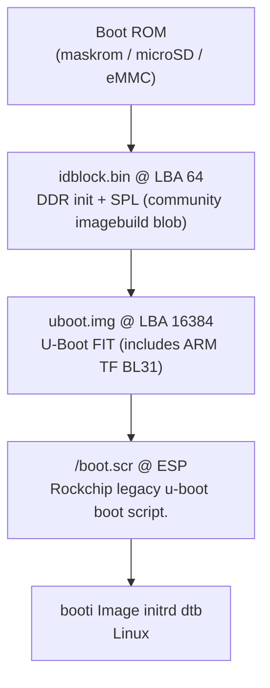

# Boot chain, partition layout, and U-Boot

<!-- toc -->

- [Boot chain, partition layout, and U-Boot](#boot-chain-partition-layout-and-u-boot)
  - [Boot chain](#boot-chain)
  - [Vendor U-Boot quirks + requirements](#vendor-u-boot-quirks--requirements)
  - [Partition layout](#partition-layout)
  - [NixOS `boot.scr` generation](#nixos-bootscr-generation)
    - [Serial & display console notes](#serial--display-console-notes)
    - [Plymouth splash](#plymouth-splash)
  - [Generation menu](#generation-menu)
  - [Interrupting U-Boot and entering UMS](#interrupting-uboot-and-entering-ums)
  - [Recovery](#recovery)
  - [Updates & maintenance](#updates--maintenance)

<!-- /toc -->

## Boot chain



> [!NOTE]
> `resource.img` @ LBA 24580 is optional and only holds bootsplash logos.

## Vendor U-Boot quirks + requirements

The vendor U-Boot build (rockchip-linux 2017.09) has some strict requirements:

1. **Partition scanning:** It runs `part list -bootable` to find GPT partitions
   marked with the `legacy_boot` flag (GPT attribute bit 2).
2. **Filesystem support:** The built-in driver only supports FAT32. Ext4, btrfs,
   and normal EFI boot will not work. It looks specifically for `/boot.scr` at
   the root of the FAT filesystem.
3. **Silent fallback:** If the target medium lacks the `legacy_boot` attribute or
   fails to load, U-Boot will move to the next bootable medium (usually internal
   eMMC). So, if microSD card boot fails with no output, check the partition
   attributes first.
4. **Modified `boot.scr` header:** Rockchip patched the payload parser to check
   for a non-standard terminator: `while (*data++ != IMAGE_PARAM_INVAL)`
   (`0xffffffff`). Usually `mkimage` writes `0x00000000`, which causes U-Boot to
   throw `SCRIPT FAILED` and fall back. So, we generate the script using
   [`../pkgs/rk-boot-script`](../pkgs/rk-boot-script) to match Rockchip's format.
5. **Runtime environment:** At boot time, U-Boot populates `${devtype}`,
   `${devnum}`, `${kernel_addr_c}`, `${fdt_addr_r}`, and `${ramdisk_addr_r}`.
6. **Argument limit:** the vendor build has `CONFIG_HUSH_PARSER=y` and
   `CONFIG_SYS_MAXARGS=16`. A `setenv bootargs …` line with more than 16 argv
   tokens (including `setenv` and `bootargs`) is rejected, and hush continues
   with the previous environment. The build-time assertion in
   [`../modules/fydetab-duo/boot-loader.nix`](../modules/fydetab-duo/boot-loader.nix)
   enforces the limit; see
   [`RECOVERY.md`](RECOVERY.md#3-the-16-argument-uboot-limit).
7. **No interactive menu or keyboard input:** this build has no `bootmenu`,
   no `sysboot`/extlinux support and no USB keyboard driver. The console input
   is the serial UART only, so it cannot present a boot menu you could operate
   from the tablet itself. Generation selection therefore happens later, in
   the initrd (see [Generation menu](#generation-menu)).

## Partition layout

| #   | Label           | Type GUID / Code | Sector Range        | Size    | Description                                                                                             |
| --- | --------------- | ---------------- | ------------------- | ------- | ------------------------------------------------------------------------------------------------------- |
| 1   | `FW`            | `8300`           | `64` – `65535`      | 32 MiB  | Raw firmware blobs (flashed at raw offsets listed above)                                                |
| 2   | `ESP`           | `ef00`           | `65536` – `1114111` | 512 MiB | FAT32 (**must have GPT attr bit 2 set**). Contains `/boot.scr`, `/boot.cmd`, kernel, initramfs, and DTB |
| 3   | `NIXOS-FYDETAB` | `8300`           | `1114112` – end     | Rest    | Root filesystem (btrfs)                                                                                 |

> [!NOTE]
> **Multiple devices with the same image:** If two storage devices (e.g., microSD and eMMC) both contain this image, they will have **identical filesystem labels** (`ESP`, `NIXOS-FYDETAB`) — and identical UUIDs, since both are baked in at image build time. `/dev/disk/by-label/ESP` may then resolve to the wrong device, causing `/boot` to mount the wrong partition.
>
> The bootloader installer (`boot-loader.nix` installHook) is safe in this scenario — it always writes boot files to the ESP on the same disk as the root filesystem, not wherever `/boot` happens to be mounted. However, if you dual-boot or switch between devices, override `hardware-configuration.nix` to use `/dev/disk/by-uuid/...` paths instead of labels to disambiguate. Check with `blkid` to find your device's UUIDs.

> [!WARNING]
> Keep the filename exactly as `rk3588s-fydetab_duo.dtb` (hyphen before `fydetab`, underscore after), as this matches conventions of the vendor's DTS. Renaming it to all-hyphens or all-underscores will break boot and leave the display black - and give you a lot of headaches!

## NixOS `boot.scr` generation

```uboot
setenv bootpart 2
setenv rootpart 3
setenv fdtfile /dtbs/rockchip/rk3588s-fydetab_duo.dtb
setenv linux_image /vmlinuz-fydetab
setenv initrd /initramfs-fydetab.img
part uuid ${devtype} ${devnum}:3 root_uuid
setenv bootargs rootfstype=btrfs rootwait rw root=PARTUUID=${root_uuid} init=@INIT@ <config.boot.kernelParams>
load ${devtype} ${devnum}:${bootpart} ${kernel_addr_c} ${linux_image}
load ${devtype} ${devnum}:${bootpart} ${ramdisk_addr_r} ${initrd}
load ${devtype} ${devnum}:${bootpart} ${fdt_addr_r} ${fdtfile}
booti ${kernel_addr_c} ${ramdisk_addr_r}:${filesize} ${fdt_addr_r}
```

If root is on a btrfs subvolume, `rootflags=subvol=<name>` is appended
automatically by
[`modules/fydetab-duo/boot-loader.nix`](../modules/fydetab-duo/boot-loader.nix).

### Serial & display console notes

- The kernel will route `/dev/console` to whichever `console=` parameter comes
  **last**. So, make sure `console=tty1` is at the end of the argument list so
  logs actually display on the panel. I wonder how this was discovered...
- `ttyFIQ0` is the hardware FIQ debugger on UART2 (1.5 MBaud).
- Arguments inside the device tree's `/chosen` node take precedence over
  U-Boot's `bootargs` in the case of duplicate keys.

### Plymouth splash

- Plymouth (`hardware.fydetabduo.plymouth.enable`) needs
  `plymouth.ignore-serial-consoles`, because `ttyFIQ0` is always a console.
  Without it Plymouth stays in text mode and the splash can appear to hang.
  The panel driver (`CONFIG_DRM_PANEL_FYDETAB`) and the Rockchip DRM stack are
  built into the kernel, so no extra initrd module is required.

`hardware.fydetabduo.plymouth.enable` defaults to `true`. It selects the
`nixonfyde` script theme from
[`../pkgs/fydetabduo-plymouth-theme`](../pkgs/fydetabduo-plymouth-theme):
the NixOS snowflake and FydeTab wordmark, a smooth ring spinner, a boot
progress bar, a password dialog, and boot messages rendered in DejaVu Sans
Mono.

## Generation menu

The vendor U-Boot cannot show a menu (see quirk 7), so generation selection
runs in the initrd instead. `hardware.fydetabduo.bootMenu` starts a picker
from the systemd initrd after the real root is mounted and before
`initrd-switch-root`:

- U-Boot still loads the normal `boot.scr`; the kernel and initrd on the ESP
  describe the current default generation, exactly as before.
- The picker lists the newest `/nix/var/nix/profiles/system-*-link`
  generations (up to `maxGenerations`, default 8) by generation number and
  timestamp. Generations with NixOS specialisations show them as foldable
  children; each specialisation is a full system closure with its own kernel
  and initrd.
- Choosing the default (or the timeout expiring, default 5 s) continues the
  normal boot. Nothing about the default path changes.
- Choosing another entry `kexec`s **that entry's own** kernel, initrd and DTB
  from the store, with `init=` rewritten in the current kernel command line.
  All generations share the root filesystem, so no ESP changes per generation
  are needed. Symlinks into `/nix/store` are resolved through `/sysroot`, so
  the initrd's own store cannot shadow them. The rewritten command line also
  carries `fydetab.bootmenu=skip`, so the kexec'd initrd boots the chosen
  entry directly instead of showing the picker again. The line also masks
  `fydetab-boot-menu.service` with `systemd.mask=`, so older generations whose
  initrd still has an older picker boot straight through as well.
- Before `kexec -e`, the picker unbinds the `wlan-platdata` platform driver.
  Its `shutdown` callback normally cuts power to the Wi-Fi card as part of
  kexec's device shutdown; the next kernel then trains the PCIe link before
  anything powers the card back on, leaving the tablet with no Wi-Fi adapter.
  The driver's `remove` path only frees the GPIOs and leaves the pad at its
  current (powered) level, so the card survives the handover.
- The countdown pauses the first time any key is pressed and stays paused for
  the rest of that boot, so the menu never boots out from under you while you
  are reading it.

The picker is a small static helper,
[`../pkgs/fydetab-boot-menu-ui`](../pkgs/fydetab-boot-menu-ui). It takes over
the display through DRM: a dumb buffer on `/dev/dri/card0` is mapped, attached
to the active CRTC and scanned out while the VT is in `KD_GRAPHICS`. (The
vendor kernel's fbdev `mmap` is broken, so `/dev/fb0` cannot be used.) Input
comes from raw `evdev` events instead of the VT keyboard layer, which is why
arrow keys move exactly one row per press. The background is generated at
build time from the Plymouth splash art (blurred and tinted), and the brand
lockup uses the theme's own snowflake and wordmark assets.

Controls: Up/Down (or `j`/`k`, volume keys, Page Up/Down, Home/End) move the
selection and repeat while held; Left/Right fold a generation open or closed;
`1`–`9` jump to a generation; Enter boots the selection; `t`, `q` or Esc boot
the default immediately. With the touchscreen, tap a row to select it; tap it
again to boot it. The default generation's `(current)` root entry returns to
the normal boot path instead of kexecing itself. Plymouth draws
through DRM, not the framebuffer, so the picker stops it for the duration of
the menu and starts it again afterwards; the menu's background is generated
from the same splash art, so the transition stays visually consistent.

The menu is drawn at 2560×1600 and rotated when written to the panel's
portrait mode. `hardware.fydetabduo.bootMenu.rotation` accepts `90` or `270`
and defaults to `270`, matching the desktop transform. Use `90` if the menu
appears upside down. No rotation is applied when the display mode is already
landscape.

It requires the keyboard: U-Boot has no input driver, and the picker runs
before userspace, so the touchscreen is not available. With the keyboard
detached, the timeout simply boots the default. If no input device can be
opened at all, the picker exits immediately and the default boots. Set
`hardware.fydetabduo.bootMenu.timeout = 0` to skip the picker entirely.

`kexec_file_load` (CONFIG_KEXEC_FILE) is used, which this kernel supports. If
loading the chosen generation fails, the picker returns to the text console on
`tty1` with an error, waits three seconds, and boots the default instead.

## Interrupting U-Boot and entering UMS

U-Boot prints `Autoboot in 1 seconds, press X to interrupt` and accepts input
only on the serial console: UART2 (`ttyFIQ0`) at **1.5 MBaud**, 3.3 V. There
is no USB keyboard support in this U-Boot, so the detachable keyboard and the
on-screen touch panel cannot interrupt autoboot.

After interrupting, U-Boot's console is at the `=>` prompt. Entering UMS
exposes a storage device to the host over USB-C:

```uboot
ums 0 mmc 0
```

Use `mmc 0` for the internal eMMC and `mmc 1` for a microSD card (matching
U-Boot's own `rkimg_bootdev` scan order: SD first, then eMMC). The host then
sees the tablet's block device and can mount the root filesystem and ESP as
described in [`RECOVERY.md`](RECOVERY.md#5-recovery-b-the-tablet-does-not-boot-uboot-ums).
Reset the tablet to leave UMS mode.

## Recovery

If the device no longer boots after a rebuild, see
[`RECOVERY.md`](RECOVERY.md) for diagnosis, rollback, and U-Boot UMS restore
procedures.
